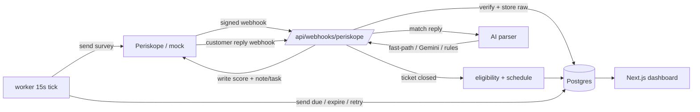

# CSAT + AI reply parser for Periskope

> Periskope measures how **fast** support is. It doesn't measure whether the customer was **happy**. This is the missing outcome layer — an external add-on, built only on Periskope's public API and webhooks, that sends a CSAT survey when a ticket closes, turns the free-text WhatsApp reply into a structured score with an LLM, and writes it back into Periskope as ticket properties and agent tasks.

Built against a real customer request that's currently **"In Review"** on Periskope's roadmap: [native CSAT for customer support evaluation](https://periskope.featurebase.app/p/native-csat-for-customer-support-evaluation).


<!-- replace with a real screenshot / GIF of the dashboard before sending -->

## Why it's interesting

- **Product-first.** Every non-obvious call is written down with the reasoning in [`docs/DECISIONS.md`](docs/DECISIONS.md); the problem, users, flow and trade-offs are in [`docs/PRODUCT_BRIEF.md`](docs/PRODUCT_BRIEF.md).
- **Runs with no WhatsApp number.** A [mock Periskope server](mock-periskope/) implements the documented API + signed webhooks and has a click-through control panel, so the whole flow is demoable today. Going live is one env var.
- **Safety-first on a real WhatsApp number.** `DRY_RUN` on by default, allowlist, send-rate cap, 7-day cooldown, 1:1-only — because the docs say 3–5 spam reports can get a number banned.

## Architecture



- **Next.js (App Router) + TypeScript** — webhook endpoint + dashboard (`/`, `/responses`, `/review`, `/settings`).
- **Postgres + Drizzle** — `webhook_events` (idempotency/raw log), `tickets_seen` (transition detection), `surveys`, `responses`, `settings`.
- **Worker** — a DB-backed poller (no Redis); sends due surveys, expires windows, retries write-backs.
- **Parser** — fast-path (number/stars/thumb, no LLM) → **Gemini** structured output (zod-validated, retried once) → low-confidence rules fallback. Provider is pluggable via `LLM_PROVIDER`.

## Quick start (mock, no WhatsApp number)

```bash
npm install
cp .env.example .env            # set DATABASE_URL (Supabase/local pg) + GEMINI_API_KEY
# keep PERISKOPE_BASE_URL=http://localhost:4010, DRY_RUN=false (safe against the mock)
npm run db:push                 # create tables (use a FRESH/empty database)
npm run simulate                # seed ~60 demo surveys so the dashboard is full
npm run dev:all                 # app :3000 + mock :4010
npm run worker                  # separate terminal
```

Open **http://localhost:3000** (dashboard) and **http://localhost:4010** (mock control panel). Set *Send delay = 0* on the Settings page for an instant demo, then click **Close ticket** in the panel. Full walkthrough: [`docs/DEMO_SCRIPT.md`](docs/DEMO_SCRIPT.md).

## Going live against real Periskope

1. Periskope trial → generate an API key → set `PERISKOPE_API_KEY`, `PERISKOPE_PHONE`.
2. `PERISKOPE_BASE_URL=https://api.periskope.app/v1`, **`DRY_RUN=true`**, `ALLOWLIST_NUMBERS=<your test number>`.
3. Expose localhost: `cloudflared tunnel --url http://localhost:3000` (or ngrok). Set the public URL.
4. `npm run setup:periskope` — idempotently creates the `CSAT Score` / `CSAT Feedback` ticket properties and prints the webhook URL + events to subscribe. Copy the Signing Key into `PERISKOPE_SIGNING_SECRET`.
5. Watch the allowlist work, then relax `DRY_RUN`.

No app code changes between mock and live — only env.

## Eval

`npm run eval` runs the **real** parser over [`evals/csat_replies.jsonl`](evals/csat_replies.jsonl) (44 hand-labelled rows: numbers, emoji, EN/Hinglish/Hindi/Portuguese/Spanish, sarcasm, mixed-feedback-with-new-issue, off-topic, and prompt-injection attempts).

| Metric | Result |
|---|---|
| Score — exact | **91.2%** (31/34) |
| Score — within ±1 | **97.1%** (33/34) |
| is_csat_response | **97.7%** (43/44) |
| new_issue detection | **97.7%** (43/44) |

(Gemini `gemini-2.5-flash`, `temperature 0`, thinking off; 0 fallbacks. The 3 score misses are all ±1 on arguable labels — sarcasm severity, mixed feedback.)

## Tests

`npm test` — 48 unit tests across eligibility rules, the transition/dedupe logic, reply matching, and parser fast-path + fallback (fixture-driven, no network).

## Known limitations

- `VERIFY` items in [`docs/RESEARCH.md`](docs/RESEARCH.md) §5 need a real account: exact status strings, whether poll votes emit a webhook, and the real signature form (raw body vs `JSON.stringify`). The verifier accepts both and records which matched.
- Eval set is 44 single-author rows — signal, not statistical proof.
- Next.js 14.2.x carries open DoS advisories in the audit DB that span essentially all versions; pinned to the latest patched 14.2 line.
- Create-Ticket-on-new-issue is note-only until the Create Ticket endpoint is wired + verified.
